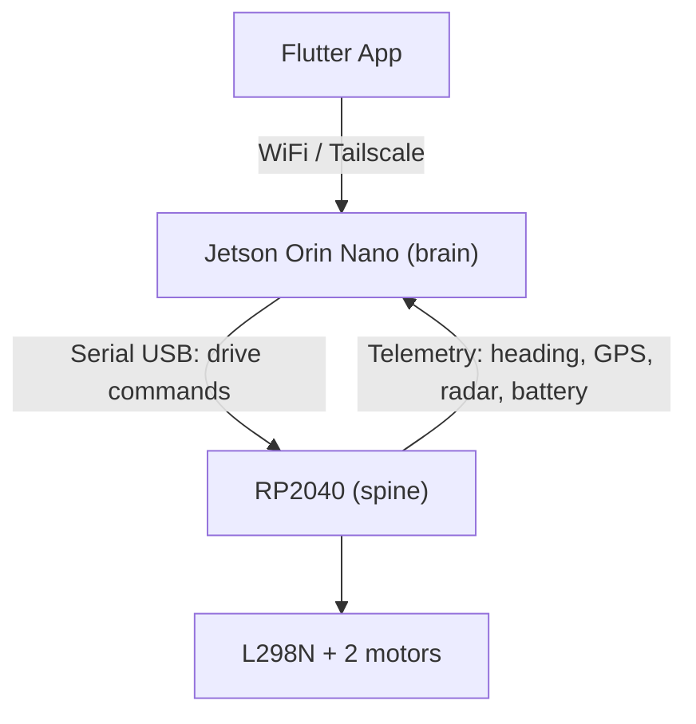

# Otto — Extension Concept

2026-09-17 · @Someone

## Part 1: Architecture Overview

Two-tier design: the RP2040 (`spine`) handles real-time driving behavior and close-range sensing, the Jetson Orin Nano (`brain`) handles perception, navigation, and AI.

| Layer | Short name | Role | Components |
| --- | --- | --- | --- |
| Flutter App | — | Remote control, display | connects to the Jetson |
| Jetson Orin Nano | `brain` | Perception, navigation, AI | Lidar, webcam, YOLO, ROS2, SLAM |
| RP2040 | `spine` | Real-time driving, close-range sensing | Motors, compass, GPS, radar, microphone, displays, color sensors |

Data flow: the Jetson sends drive commands (`V,linear,angular`) to the RP2040, and the RP2040 sends telemetry back. A watchdog on the RP2040 stops the motors if no command arrives for 500 ms.

## Part 2: Jetson Orin Nano — Vision, Navigation, RP2040 Connection

The Jetson bundles the lidar, webcam, and serial control of the RP2040, and becomes the central WiFi/Tailscale node for the Flutter app.

| Component | Connection | Note |
| --- | --- | --- |
| WitMotion COIN-D6 lidar | USB (via UART adapter, 230400 baud) | ROS2 driver per manufacturer documentation |
| Webcam | USB | replaces the ESP32-CAM, feeds the Flutter app and YOLO |
| RP2040 | USB (serial) | drive commands out, telemetry in |

### Why the lidar sits on the Jetson (not the RP2040)

- The COIN-D6 delivers a continuous UART data stream at 4000 samples/s that must be processed in real time for SLAM/mapping — that needs compute the RP2040 doesn't have.
- ROS2, Nav2, and SLAM packages (RTAB-Map, Cartographer) practically only run on a Linux system like the Jetson, not on a microcontroller.
- Lidar data has to be fused with camera and GPS/compass data on a shared time base (the ROS2 TF tree) — that happens on the Jetson anyway.
- If the lidar sat on the RP2040, the scan data would additionally have to be relayed over the serial link to the Jetson — that would load the connection reserved for drive commands and add latency and another failure point, without taking any load off the RP2040.

Both USB devices (lidar, RP2040) need fixed udev rules so `/dev/ttyUSBx` numbers don't swap on every reboot.

### Software stack

- JetPack (current version; check TensorRT compatibility beforehand)
- ROS2 (Humble/Jazzy depending on the JetPack Ubuntu version)
- OpenCV + PyTorch/YOLO via NVIDIA wheels or `jetson-containers`, not via pip
- RTAB-Map or Cartographer for SLAM/mapping
- `robot_localization` for fusing compass, GPS, and odometry
- Tailscale for remote access and the connection to the Flutter app

## Part 3: RP2040 — Sensors, Motor Control, Pin Budget

The existing ESP32 board has 2 fewer pins than assumed — switching to the RP2040 (Raspberry Pi Pico) already on hand. The RP2040 has 26 usable GPIOs (GP0–GP22, GP26–GP28), no flash or boot-strapping restrictions like the ESP32, and flashes over USB (BOOTSEL) instead of a UART — so GP0/GP1 are freely usable. Two PIO blocks additionally emulate UART/I2S/SPI-like protocols on arbitrary pins, with no CPU load.

### Motor pins

`Motor_L298(pinEnable, pinIn1, pinIn2, pwmChannel)` — channels on the RP2040 via the PWM slices; every GPIO is PWM-capable.

| Motor | Enable (PWM) | IN1 | IN2 |
| --- | --- | --- | --- |
| left | GP2 | GP3 | GP4 |
| right | GP5 | GP6 | GP7 |

### Pin assignment (need 22, available 26 → 4 pins spare)

| Group | Pins | Components |
| --- | --- | --- |
| Motors | GP2–GP7 | 2× L298N channel |
| I2C0 | SDA=GP8, SCL=GP9 | GY-273, TCS34725, PCF8575 expander |
| SPI0 (displays) | SCK=GP10, MOSI=GP11, DC=GP12, CS1=GP13, CS2=GP14 | 2× GC9A01 (RST hardwired to 3.3 V) |
| I2S (PIO) | BCLK=GP15, WS=GP16, SD=GP17 | INMP441 |
| Jetson link (UART0) | TX=GP0, RX=GP1 | serial link to the Jetson |
| GPS (RX only) | GP18 | Neo-6M, broadcasts NMEA unprompted |
| Radar (PIO UART) | TX=GP19, RX=GP20 | HLK-LD2402 |
| TCS3200 (TSC230) OUT | GP21 | S0–S3/OE via PCF8575 |
| WT588D, rain sensor, vibration sensor | via PCF8575 | trigger/status lines |
| spare | GP22, GP26, GP27, GP28 | reserve for later |

Total: 22 native pins out of 26 available — 4 pins spare, with none of the ESP32's boot caveats.

Offene Frage: Entscheidung Expander vs. ESP32-S3 zuerst treffen, dann GPS, Radar und WT588D auf die verbleibenden Pins bzw. Software-Serial verteilen.

Update: decision made — PCF8575 for the rain sensor, vibration sensor, WT588D, and the TCS3200 control lines; see the pin-requirement table above.
