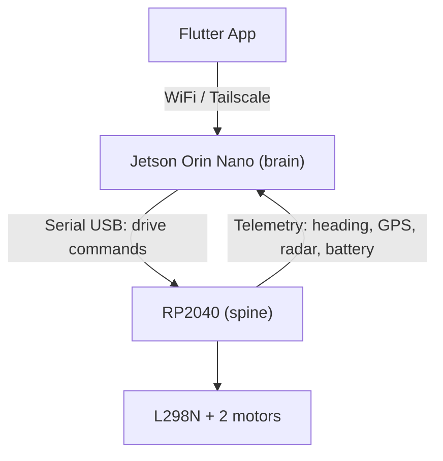

# Otto — Extension Concept

2026-09-17 · @Someone

## Part 1: Architecture Overview

Two-tier design: the RP2040 (`spine`) handles real-time driving behavior and close-range sensing, the Jetson Orin Nano (`brain`) handles perception, navigation, and AI.

| Layer | Short name | Role | Components |
| --- | --- | --- | --- |
| Flutter App | — | Remote control, display | connects to the Jetson |
| Jetson Orin Nano | `brain` | Perception, navigation, AI | Lidar, webcam, YOLO, ROS2, SLAM |
| RP2040 | `spine` | Real-time driving, close-range sensing | Motors, compass, GPS, radar, microphone, displays, head servo, rain/light/vibration sensors |

Data flow: the Jetson sends drive commands (`V,linear,angular`) to the RP2040, and the RP2040 sends telemetry back. A watchdog on the RP2040 stops the motors if no command arrives for 500 ms.

## Part 2: Jetson Orin Nano — Vision, Navigation, RP2040 Connection

The Jetson bundles the lidar, webcam, and serial control of the RP2040, and becomes the central WiFi/Tailscale node for the Flutter app.

| Component | Connection | Note |
| --- | --- | --- |
| WitMotion COIN-D6 lidar | USB (via UART adapter, 230400 baud) | ROS2 driver per manufacturer documentation |
| Webcam | USB | replaces the ESP32-CAM, feeds the Flutter app and YOLO |
| RP2040 | USB (serial) | drive commands out, telemetry in |

### Why the lidar sits on the Jetson (not the RP2040)

- The COIN-D6 delivers a continuous UART data stream at 4000 samples/s that must be processed in real time for SLAM/mapping — that needs compute the RP2040 doesn't have.
- ROS2, Nav2, and SLAM packages (RTAB-Map, Cartographer) practically only run on a Linux system like the Jetson, not on a microcontroller.
- Lidar data has to be fused with camera and GPS/compass data on a shared time base (the ROS2 TF tree) — that happens on the Jetson anyway.
- If the lidar sat on the RP2040, the scan data would additionally have to be relayed over the serial link to the Jetson — that would load the connection reserved for drive commands and add latency and another failure point, without taking any load off the RP2040.

Both USB devices (lidar, RP2040) need fixed udev rules so `/dev/ttyUSBx` numbers don't swap on every reboot.

### Software stack

- JetPack (current version; check TensorRT compatibility beforehand)
- ROS2 (Humble/Jazzy depending on the JetPack Ubuntu version)
- OpenCV + PyTorch/YOLO via NVIDIA wheels or `jetson-containers`, not via pip
- RTAB-Map or Cartographer for SLAM/mapping
- `robot_localization` for fusing compass, GPS, and odometry
- Tailscale for remote access and the connection to the Flutter app

## Part 3: RP2040 — Sensors, Motor Control, Pin Budget

The existing ESP32 board has 2 fewer pins than assumed — switching to the RP2040 (Raspberry Pi Pico) already on hand. The RP2040 has 26 usable GPIOs (GP0–GP22, GP26–GP28), no flash or boot-strapping restrictions like the ESP32, and flashes over USB (BOOTSEL) instead of a UART — so GP0/GP1 are freely usable (GP0 is now DFPlayer RX, GP1 the head servo). Two PIO blocks additionally emulate UART/I2S/SPI-like protocols on arbitrary pins, with no CPU load.

### Motor pins

`Motor(pinEnable, pcf, bitIn1, bitIn2)` — the enable pin is a native RP2040 PWM pin (every GPIO is PWM-capable); the two direction inputs sit on PCF8574P ports (I2C), which frees GP3/GP4/GP6/GP7. Stopping only needs EN low, so an I2C fault cannot keep a motor running.

One L298N board per motor (not a shared 2-channel driver), both internal
H-bridges of each board jumpered in parallel for a higher per-motor
current rating (~3–4A vs ~2A). Carried over from the previous `hermann`
platform. Full jumpering and power wiring in
[`20_hardware/motor-wiring.md`](../20_hardware/motor-wiring.md).

| Motor | Enable (PWM) | IN1 | IN2 |
| --- | --- | --- | --- |
| left | GP2 | PCF8574P P2 | PCF8574P P3 |
| right | GP5 | PCF8574P P4 | PCF8574P P5 |

### Pin assignment (need 21, available 26 → 5 pins spare)

Color sensors (TCS3200, TCS34725) removed from the design. WT588D
(parallel/key-trigger sound module) replaced by a **DFPlayer Mini**
(UART-controlled, plays numbered files off a microSD card) — see the
Audio section below for why this also changes what the PCF8574 is used
for.

| Group | Pins | Components |
| --- | --- | --- |
| Motors | EN = GP2, GP5 (PWM); IN1/IN2 via PCF8574P P2–P5 | 2× L298N board, 1 per motor, H-bridges paralleled |
| I2C0 | SDA=GP8, SCL=GP9 | GY-273 (compass, mounted on the deck, away from motors/12V wiring), 1× PCF8574P expander (addr. 0x20, default, no jumper) |
| SPI0 (displays) | SCK=GP10, MOSI=GP11, DC=GP12, CS1=GP13, CS2=GP14 | 2× GC9A01, 7-pin variant (VCC/GND/SCL/SDA/DC/CS/RST, no BLK — backlight wired internally to VCC, always on); RST hardwired to 3.3 V; VDD 3.3 V only — 2.8-3.3 V per datasheet, not 5 V-tolerant |
| I2S (PIO) | BCLK=GP15, WS=GP16, SD=GP17 | INMP441 |
| GPS (RX only) | GP18 | Neo-6M, broadcasts NMEA unprompted |
| Radar (PIO UART + presence GPIO) | TX=GP19, RX=GP20, IO=GP22 | HLK-LD2402 |
| Audio (PIO UART) | TX=GP21, RX=GP0 | DFPlayer Mini |
| Vibration sensor, DFPlayer BUSY | via PCF8574P (P0, P1) | digital inputs; P2–P5 motor direction outputs, P6/P7 free |
| Head servo (MG995) | GP1 (`SERVO_HEAD`, PWM 50 Hz) | rotates the head, ~180° range, no angle feedback; 5V from the logic rail, 1000µF cap at connector J1 |
| Rain sensor (analog) | GP26 (ADC0) | MH-RD module AO only, DO unconnected |
| Photoresistor | GP27 (ADC1) | divider 3.3V → 10kΩ → node → LDR → GND, node to GP27 |
| spare | GP3, GP4, GP6, GP7, GP28 | GP3/4/6/7 freed by moving motor direction to the PCF8574P; GP28 is ADC-capable (ADC_VREF decoupled with 220nF) |

Total: 21 native pins out of 26 available — 5 pins spare (GP3, GP4, GP6, GP7, GP28), with none of the ESP32's boot caveats. PCF8574P: 6 of 8 ports used (P6/P7 free). Direction changes cost one I2C write (~200 µs at 100 kHz); the firmware re-sends the direction byte every 20 ms so a disturbed transfer self-heals.

HLK-LD2402 detail: module in use is ICGOICIC HLK-LD2402-V1.0, 5-pin header labeled **V, IO, G, TX, RX**. Powered at **V=3.3V** (officially supported range 3.0-3.6V per the product description, ~50mA average) rather than 5V — this pins the TX/RX/IO output level to 3.3V by construction (an output can't exceed its own supply), so no level-shifting or pre-connection voltage check is needed. IO is the presence-detect GPIO (independent of the UART stream), wired to GP22 (kept off the ADC-capable GP26-28 pins, which are needed for analog sensors). Since this pushed the module onto the 3.3V rail, it's supplied from the same external 3.3V/1A regulator as the displays and the rest of the 3.3V peripherals, not the Pico's onboard regulator — see [`20_hardware/wiring-reference.md`](../20_hardware/wiring-reference.md) for the current 3.3V-rail split.

The Jetson link uses the RP2040's native USB (USB-CDC serial), not a wired UART0 — GP0/GP1 are therefore not reserved (now used for DFPlayer RX and the head servo).

Offene Frage: Entscheidung Expander vs. ESP32-S3 zuerst treffen, dann GPS, Radar und WT588D auf die verbleibenden Pins bzw. Software-Serial verteilen.

Update (superseded, kept for history): a PCF8574 expander was originally planned for the WT588D sound module's parallel/key-trigger control lines (7 trigger + 1 busy, filling an entire 8-bit chip on its own), with color-sensor and rain/vibration lines on a second chip.

**Update — WT588D replaced by DFPlayer Mini:** the WT588D (parallel/key-trigger sound module) is replaced by a **DFPlayer Mini**, controlled over UART instead of trigger lines (play track N off a microSD card — trivially supports "as many tracks as possible, at least 64" by just naming files `0001.mp3`, `0002.mp3`, ... no combination-trigger trick needed). This removes the PCF8574's original reason for existing. Since the color sensors were already dropped earlier (freeing GP21, previously TCS3200's OUT pin), the DFPlayer's UART now uses GP21 (TX) and GP0 (RX) — see the Audio section below for the wiring. The PCF8574P stays in the design, repurposed for the vibration sensor and the DFPlayer BUSY input (simple low-pin-count I/O expansion), back at its default address 0x20. The rain sensor was later moved to an analog read on GP26.

### Audio: DFPlayer Mini

Replaces the WT588D. Powered at **5V** (module supports 3.2–5.0V; 5V gives full amplifier headroom for louder output). Controlled via PIO-UART on GP21 (TX, Pico→module) / GP0 (RX, module→Pico), 9600 baud (module default).

Since the module runs at 5V, its TX output is 5V logic — too high for the RP2040's 3.3V-only GPIOs. Level-safety measures (see [`20_hardware/wiring-reference.md`](../20_hardware/wiring-reference.md) for exact values):
- Pico TX → module RX: ~1kΩ series resistor (standard, widely-documented safety margin; the module's RX threshold reads 3.3V logic reliably).
- Module TX → Pico RX: resistor voltage divider (5V → ~3.3V) — required, not optional, since a bare 5V input on GP0 risks damaging the pin.

**Update — BUSY-pin wired after all:** contrary to the original "UART-only" decision, the DFPlayer's BUSY output is now connected to PCF8574 port P1 — a quick "currently playing" status without a UART query. See [`20_hardware/wiring-reference.md`](../20_hardware/wiring-reference.md) for the port table.

### 5V power budget

Logic/sensor rail, separate from the 12V motor supply to the L298N. Supplied by a dedicated 5V/3A DC-DC converter, not the L298N's onboard 5V logic regulator — motor inrush current would otherwise sag the sensor/display supply.

**Sizing note:** this rail directly carries GPS Neo-6M, the DFPlayer Mini + speaker and the **head servo (MG995)**, **plus** the external 3.3V regulator's input current (that regulator is itself fed from this 5V rail, so its load counts here too — easy to forget since its own consumers, like the displays, aren't obviously "5V devices"). Worst case sums to ~2.7A (see table below; servo stalled + DFPlayer at full volume at the same time, unlikely), within the 3A converter budget (~0.3A margin worst case). The converter therefore has to deliver a true 3A continuous. An earlier version of this doc specified 5V/5A (~3A continuous), sized back when GC9A01, HLK-LD2402, the color sensors, and WT588D were all direct 5V consumers on this rail (before the 3.3V-rail split existed); that spec was never re-checked after the redesign. Before the servo was added, 2A gave ~40% margin (worst case ~1.26A); the MG995's stall current (~1.4A) raised the rail to 3A.

**3.3V split — decided:** the RP2040 chip itself can't be electrically detached from the Pico's onboard regulator (VBUS from the native USB link to the Jetson always energizes VSYS, which always drives the onboard regulator) — but that load is trivial (~30-50mA). Every other 3.3V device (GY-273, INMP441, PCF8574P, rain/vibration sensors, photoresistor divider, 2× GC9A01, HLK-LD2402) instead runs off a single external 3.3V/1A standard regulator branched off this 5V rail, not the Pico's regulator — a standard regulator's input current tracks its output current, so their mA figures below are still a valid draw on this 5V rail. Total worst-case draw on that external 1A regulator is ~220-290mA, comfortable margin. See [`20_hardware/wiring-reference.md`](../20_hardware/wiring-reference.md) for the full reasoning (including why powering the Pico's 3V3 pin externally isn't safe here, and why 5V shouldn't be tapped from the Pico's USB/VBUS pin).

Note: RP2040 itself is **not** on this rail — it's powered via its own native-USB VBUS from the Jetson, not from this battery-fed 5V converter (see the 3.3V split note above).

| Component | Typical | Worst case |
| --- | --- | --- |
| GPS Neo-6M (onboard 5V regulator) | ~45mA | ~70mA (fix acquisition) |
| DFPlayer Mini + speaker | ~20mA (idle/standby) | ~500–900mA (playing near max volume, 3W/4Ω amplifier) |
| Head servo MG995 (J1, 1000µF cap) | ~10mA (idle) | ~1400mA (stalled; ~250–500mA when moving) |
| External 3.3V/1A regulator (input current, ≈ its output load: GY-273, INMP441, PCF8574P, rain/vibration/photo sensors, 2× GC9A01, HLK-LD2402) | ~120–160mA | ~220–290mA |
| **Total** | **~195–235mA** | **~2190–2660mA** |

The DFPlayer + speaker draw is the biggest unknown until the actual speaker is on hand — measure it directly once available. Worst case (~2.7A, servo stalled and DFPlayer at full volume simultaneously) stays within the 5V/3A DC-DC converter's budget; typical operation stays below ~0.5A. Software should ramp servo moves and avoid stalling it.

### Jetson power supply (19V)

The official Jetson Orin Nano Developer Kit expects 19V on its 5.5×2.5mm barrel jack; NVIDIA's own supply is rated 19V/3.42A (≈65W), sized to cover the Jetson module plus carrier-board peripherals (NVMe, fan, USB devices — webcam, RP2040). This rail is separate from both the 12V motor rail and the 5V logic rail above.

An on-hand generic **XL6009 boost module** (TO-263 XL6009E1, no heatsink) was evaluated for stepping the 11V battery (3S LiPo) up to 19V and found **insufficient**:

- Full 65W budget at 11V input, ~85% efficiency → ≈7A input current required — well past the XL6009's internal ~4A switch current limit.
- Jetson module alone (~25W) → ≈2.7A input current — inside the chip's rated limit, but with no margin for GPU inference bursts or peripheral inrush.
- No heatsink on the switching IC risks thermal throttling/shutdown in an enclosed chassis, which would brownout the Jetson mid-drive (filesystem/SLAM-stack risk).
- 3S LiPo sags to ~9.9–10.5V under load/near discharge, worsening the step-up ratio and current draw exactly when the battery is weakest.

Decision needed: replace with a dedicated 12V→19V boost module rated for ≥5A continuous output with its own heatsink/fan (purpose-built modules for powering a Jetson from a battery exist) before running the Jetson off this rail. See [`20_hardware/wiring-reference.md`](../20_hardware/wiring-reference.md) (Offene Punkte) for the full analysis.
