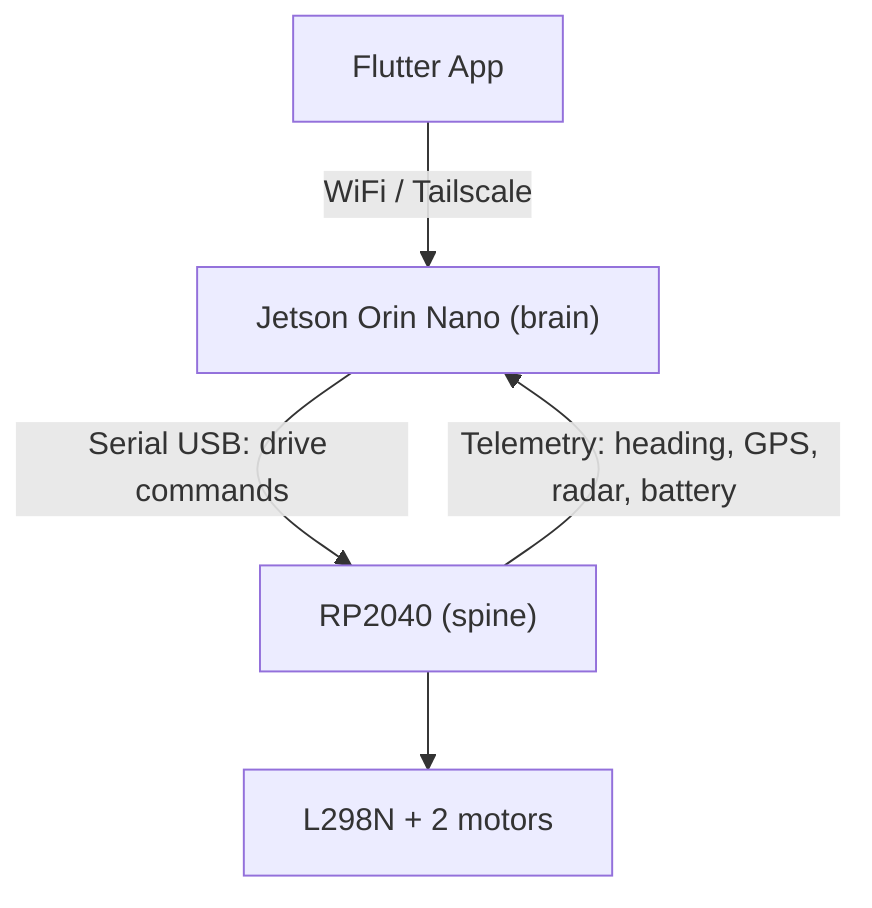

# Otto — Autonomous Garden Robot

Otto is a garden robot being built up incrementally from an existing WiFi-controlled RC platform into an autonomous, sensor-rich system. It moves through the garden today under manual control from a Flutter app, and is being extended with lidar-based navigation, computer vision (animal detection, garden mapping), and a range of environmental sensors.

## Architecture

Otto uses a two-tier design that splits real-time driving from perception and planning:



| Layer | Short name | Role |
| --- | --- | --- |
| Jetson Orin Nano | `brain` | Perception, navigation, AI — lidar, webcam, YOLO, ROS2, SLAM |
| RP2040 | `spine` | Real-time driving and close-range sensing — motors, compass, GPS, radar, microphone, displays, head servo, rain/light/vibration sensors |
| Flutter App | — | Remote control and live camera view, connects to the Jetson |

The full hardware and pin-budget breakdown lives in [`10_concepts/otto-concept.md`](10_concepts/otto-concept.md).

## Hardware

**Jetson Orin Nano (`brain`)**
- WitMotion COIN-D6 dTOF lidar (360°, 12 m range, USB/UART, 230400 baud)
- USB webcam (replaces the earlier ESP32-CAM), feeds both the app and onboard object detection
- Runs JetPack, ROS2, OpenCV/YOLO, and acts as the WiFi/Tailscale endpoint for the app

**RP2040 (`spine`)**
- 2× DC motors via an L298N driver
- GY-273 compass (on the deck, away from the motors)
- GPS Neo-6M
- HLK-LD2402 human-presence radar
- INMP441 I2S microphone
- 2× GC9A01 round SPI displays (robot "eyes")
- MG995 servo rotating the head (~180°)
- DFPlayer Mini sound module (UART, microSD)
- Rain sensor (analog, ADC), photoresistor (ADC), vibration sensor (via a PCF8574P I2C expander)

## App Control

The Flutter app is the primary interface to Otto:

- Connects to the Jetson over WiFi or Tailscale (not directly to the RP2040)
- Streams the live camera feed from the webcam
- Sends drive commands, which the Jetson relays to the RP2040 over serial
- Displays telemetry reported back by the RP2040 (heading, GPS fix, radar events, battery level)

### Jetson ↔ RP2040 protocol

The Jetson and RP2040 talk over a serial USB link using a simple line-based protocol:

```
Jetson → RP2040:  V,<linear_mm_s>,<angular_mrad_s>\n
RP2040 → Jetson:  T,<heading_deg>,<lat>,<lon>,<gps_fix>,<radar>,<batt_mV>\n
```

`heading_deg` is `-1.0` when the compass read failed. `V` values must be finite numbers; anything else is rejected with an `invalid value` message.

A watchdog on the RP2040 stops the motors if no drive command arrives within 500 ms, independent of the state of the serial connection or the app. A second, hardware watchdog (1 s) resets the RP2040 if the main loop ever hangs (e.g. a stuck I2C bus); I2C transfers also have a 25 ms timeout.

## Build & Flash (spine)

- Toolchain: Arduino IDE 2 / `arduino-cli` with the [arduino-pico](https://github.com/earlephilhower/arduino-pico) core (board package URL: `https://github.com/earlephilhower/arduino-pico/releases/download/global/package_rp2040_index.json`).
- Board: `rp2040:rp2040:rpipico`, USB Stack: *Pico SDK* (native USB-CDC serial).
- Build and upload (hold BOOTSEL while plugging in the first time, later uploads reset automatically):

```bash
arduino-cli core install rp2040:rp2040 --additional-urls <package URL above>
arduino-cli compile --fqbn rp2040:rp2040:rpipico 30_spine/spine
arduino-cli upload  --fqbn rp2040:rp2040:rpipico -p /dev/ttyACM0 30_spine/spine
```

- Test: open the serial monitor at 115200 baud with *Newline* line ending and type `?` for the list of manual commands.

## Status

- Manual driving over WiFi: working (current platform)
- Lidar, webcam, RP2040 sensor suite: in progress, see `10_concepts/otto-concept.md` for the current build plan
- Autonomous navigation, garden mapping, animal detection: planned
- Visitor interaction over the garden fence: planned ("advanced" stretch goal)

## Repository Layout

```
10_concepts/
  otto-concept.md   — architecture, hardware, and pin-budget concept document
20_hardware   — description of hardware & 3D mechanics
30_spine   — RP2040 based software for sensor reading
40_brain   — Jetson Orin Nano: spine bridge, app API, (later) ROS2/navigation
50_app     — Flutter remote-control app (joystick, live video), talks to the Jetson
```
